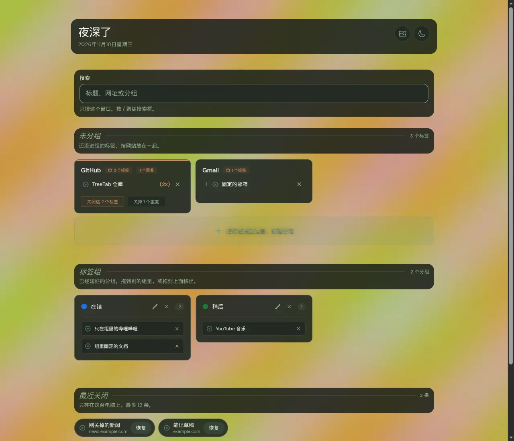
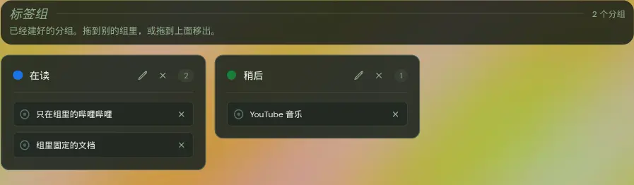

# TreeTab

把 Chrome 新标签页变成一块只看**当前窗口**的整理台。打开新标签，大约三秒内能看清哪些标签还散着、哪些已经进组，然后搜、关、拖、恢复。

> 这是一个**玩儿的项目**（playground）——用 AI 编码工具边玩边写的 Chrome 扩展，功能以自己够用为准，不承诺长期维护，也不是要上架的产品。

## 它做什么

新标签页分成两块，各干一件事：

- **上面 · 未分组**：还没进 Chrome 标签组的页面，按网站收在一起。重复的会标出来，可以关掉重复，或关掉这一网站里能关的标签。固定的标签会留下来。
- **下面 · 标签组**：只显示已经建好的分组。拖进去、拖到别的组、拖回上面移出，也可以改名。关掉整个分组要再点一次确认，而且不会顺手关掉固定的标签。

两块不再把同一批标签各列一遍。没有分组时，下面整块会藏起来。

另外：

- **搜索**：只过滤这个窗口里的标题、网址和分组名。按 `/` 聚焦，方向键能在结果间移动。搜索进行时，不会出现「关掉整组」——那会连没显示出来的标签一起关。
- **最近关闭**：扩展自己记下刚关掉的页面（最多 12 条，同一个网址只留一条），点「恢复」在当前窗口重新打开。不申请 `sessions` 权限，不上传，关掉浏览器再开也还在这台电脑上。
- 别的标签页有开关、换组、改名，看板大约 0.3 秒内会跟上。自定义背景、深色模式、工具栏上的数量徽章都还在。背景图上面的卡片和标题垫了一层纸色，字不会被照片洗掉，壁纸本身还看得到。

批量关闭和删除分组都要连点两次。钉住的标签不会被批量关掉。

**100% 本地**。无账号、无服务器、无统计、无外链字体。新标签页不请求任何第三方接口，偏好、背景图和「最近关闭」都在 `chrome.storage.local`，标签快照在 `chrome.storage.session`，不会离开这台设备。各标签的小图标用的是浏览器已经给这个页面的 favicon。

## 界面

标签组卡片：分组颜色、组里的页面、改名，拖拽换组。移出分组是拖回上面的「未分组」。

## 安装

1. `git clone` 本仓库（或下载 ZIP 解压）
2. 打开 `chrome://extensions`，开启右上角**开发者模式**
3. 点**加载已解压的扩展程序**，选择 `extension/` 子文件夹（不是仓库根目录）
4. 开一个新标签页

> 也可以直接把仓库链接扔给编码 Agent，说「install this」。

改完源码后，在扩展管理页点一次重新加载即可。没有构建步骤。

## 技术

Chrome Manifest V3，**无构建步骤**——`extension/` 里的 HTML/CSS/JS 就是全部源码。音效由 Web Audio API 合成，没有音频文件。拉丁字母用 `extension/fonts/` 里的可变字体（OFL 1.1），中文走系统里已经有的字体，不从网上拉字体。

权限只有 `tabs`、`storage`、`tabGroups`。没有 `sessions`，也没有主机权限。

## 致谢与许可

基于 [TabOut](https://github.com/zarazhangrui/tab-out)（MIT）开发而来，感谢原作者。本项目同样以 [MIT](LICENSE) 许可发布。
